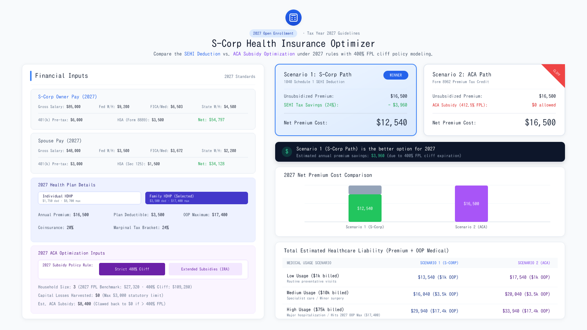

# S-Corp Health Insurance Optimizer (2027 Rules)

[](https://ais-pre-su4ghorqufbaxhjw3dqqi2-22665826049.us-west2.run.app)
[](https://aistudio.google.com)
[](https://react.dev/)
[](https://www.typescriptlang.org/)
[](LICENSE)

> A modern financial modeling engine designed for S-Corporation owners (>2% shareholders) and CPAs to evaluate and optimize health insurance funding strategies under **Tax Year 2027 statutory guidelines**.

---

## 📸 2027 Application Preview



---

## 🚀 Quick Launch

| Environment | Link / Action | Description |
| :--- | :--- | :--- |
| 🌐 **Live Web Application** | [**Launch Optimizer App**](https://ais-pre-su4ghorqufbaxhjw3dqqi2-22665826049.us-west2.run.app) | Instant access to the hosted production applet on Google Cloud. |
| ⚡ **Open in Google AI Studio** | [**Open in AI Studio Build**](https://aistudio.google.com) | Fork, customize, or build upon this applet in your own Google AI Studio project. |
| 💻 **Local Development** | [**Developer Setup Guide**](#-local-developer-setup) | Clone and run locally using Vite and Node.js. |

---

## 🎯 Purpose & Core Decision

For S-Corp owners (2% shareholders), health insurance coverage offers two distinct paths that are frequently in conflict:

1. **Scenario 1: S-Corp Deduction Path (SEHI)**
   * Premium is paid or reimbursed by the S-Corporation.
   * Reported as taxable compensation in **Box 1 of Form W-2**, but exempt from FICA/Medicare under **IRS Notice 2008-1**.
   * Claimed as an above-the-line deduction on **Form 1040 Schedule 1 (Line 17)**, limited to S-Corp Medicare wages.
   * *Primary benefit:* Effectively pays premiums with 100% income-tax-free dollars without ACA eligibility risk.

2. **Scenario 2: ACA Subsidies Path (PTC)**
   * Premium is paid personally with after-tax funds (foregoing the SEHI deduction).
   * Qualifies for the **Premium Tax Credit (PTC) via Form 8962** based on household Modified Adjusted Gross Income (MAGI).
   * *Primary benefit:* Subsidies can dramatically reduce net premium costs if household MAGI remains safely below statutory thresholds.

---

## ✨ 2027 Key Features

* **2027 HHS Federal Poverty Guidelines:** Accurate baseline calculations based on official 2027 coverage year guidelines ($15,960 base for 1 person + $5,680 per additional person in the 48 contiguous states & D.C.).
* **Strict 400% FPL Cliff vs. Policy Extension Toggle:** 
  * *Strict 400% Cliff (Standard 2027 Rule):* Subsidies automatically drop to $0 once MAGI crosses 400% FPL ($63,840 for single, $109,280 for family of 3).
  * *Enhanced Subsidies (Extension Scenario):* Simulates continued subsidies with household contributions capped at 8.5% of income.
* **Actionable Cliff Gap Calculation:** Informs you of the exact dollar amount household MAGI exceeds the 400% FPL threshold, recommending pre-tax 401(k), HSA, or capital loss harvesting adjustments to recapture eligibility.
* **2027 Statutory HDHP & HSA Presets:** Quick-select presets for **Individual HDHP** ($1,750 deductible / $8,700 OOP max) and **Family HDHP** ($3,500 deductible / $17,400 OOP max) alongside updated 2027 HSA contribution limits ($4,500 individual / $9,000 family).
* **Total Cost of Ownership (TCO) Modeling:** Evaluates net premium combined with out-of-pocket costs across Low ($1,000), Medium ($10,000), and High/Catastrophic ($75,000) medical utilization scenarios.
* **AI Financial Advisor with Search Grounding:** Powered by **Google Gemini 3.8 Flash** with live Google Search grounding to cite 2027 IRS notices and Form 8962 rules.

---

## 🛠️ Open in Your Own Google AI Studio Project

Anyone can import and run this repository in their own Google AI Studio project to modify prompts, add features, or connect their own Google Cloud environment:

1. Visit [Google AI Studio](https://aistudio.google.com).
2. Click **Create New Applet** or **Import**.
3. Select **Import from GitHub** and enter this repository URL:
   ```
   https://github.com/djKianoosh/s-corp-health-insurance-optimizer
   ```
4. AI Studio will automatically build the container and deploy the app to your private development environment.
5. In **Settings > Secrets**, your `GEMINI_API_KEY` is automatically provisioned for the AI Financial Advisor.

---

## 💻 Local Developer Setup

If you prefer to run and develop the application locally:

### 1. Prerequisites
* **Node.js**: v20 or higher
* **Package Manager**: npm, pnpm, or bun

### 2. Clone the Repository
```bash
git clone https://github.com/djKianoosh/s-corp-health-insurance-optimizer.git
cd s-corp-health-insurance-optimizer
```

### 3. Install Dependencies
```bash
npm install
```

### 4. Configure Environment (Optional)
To use the Gemini AI Advisor locally, create a `.env.local` file:
```bash
GEMINI_API_KEY=your_gemini_api_key_here
```

### 5. Start the Development Server
```bash
npm run dev
```
Open [http://localhost:3000](http://localhost:3000) in your browser.

### 6. Build for Production
```bash
npm run build
```

---

## 🔒 Privacy & Security

* **100% Client-Side Calculations:** All mathematical computations and tax simulations run entirely within your local browser runtime.
* **Zero Database Storage:** This application does not connect to an external database to store or track user inputs or financial records.
* **Secure AI Processing:** When invoking the AI Financial Advisor, only the anonymized numeric inputs visible on screen are sent to the Gemini API for qualitative synthesis.

---

## 📄 License

This project is open-source under the [MIT License](LICENSE).